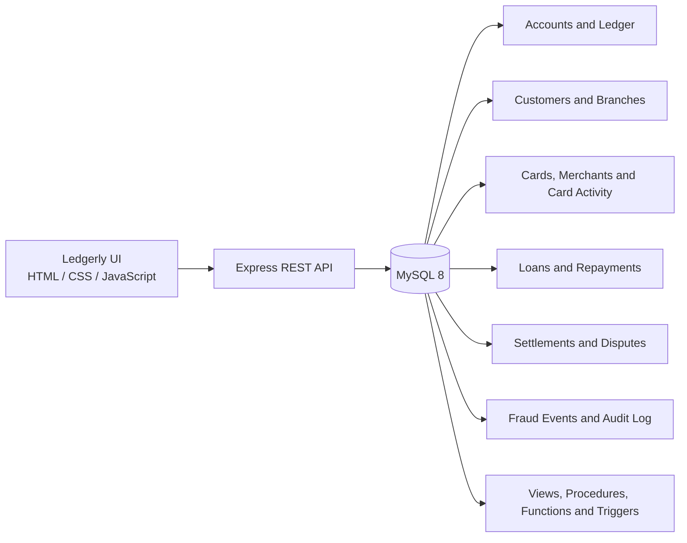

# Banking & Financial Transaction Management System

A portfolio project that combines **MySQL 8.0+, advanced SQL, an Express REST API, and the Ledgerly browser dashboard** to explore synthetic banking transactions and related financial operations.

The repository includes a relational schema, seeded demonstration records, 28 numbered SQL exercises/modules, an optional idempotent operations-data script, reusable database objects, and a small full-stack interface.

> **Portfolio demo only:** this is not a production banking application. Use only synthetic data and a private development database. Transfers are disabled by default and must never be enabled against a real financial database.

## Highlights

- Relational model for branches, customers, accounts, transactions, transfers, cards, card transactions, merchants, loans, repayments, fraud events, disputes, settlements, and audit records.
- SQL analytics using joins, correlated subqueries, CTEs, window functions, date ranges, customer/account KPIs, settlement metrics, and transparent rule-based risk review.
- MySQL views, stored procedures, deterministic functions, validation/audit triggers, constraints, and transaction examples.
- Express API with parameterized SQL queries and a MySQL connection pool.
- Responsive dashboard with account/customer search, transaction filtering, overview metrics, analytics, loan/fraud tables, CSV export, database-health status, and demo transfer workflow.
- Deployment and maintenance references in `DEPLOYMENT.md`, `SECURITY.md`, `docs/API.md`, and `docs/QA_CHECKLIST.md`.

## Architecture



## SQL Modules

| Files | Focus |
|---|---|
| `01_database_schema.sql`–`03_constraints.sql` | Schema initialization, relational tables, keys and constraints |
| `04_reference_data.sql`–`07_transaction_data.sql` | Synthetic branch/merchant/customer/account/ledger records |
| `08_basic_queries.sql`–`12_window_functions.sql` | Filtering, aggregation, joins, subqueries, CTEs and window functions |
| `13_transaction_analytics.sql`–`18_payment_analytics.sql` | Transactions, customers, accounts, cards, lending, repayments and settlements |
| `19_fraud_analysis.sql`–`21_financial_analytics.sql` | Investigation candidates, rule-based risk indicators and financial reporting |
| `22_views.sql`–`25_triggers.sql` | Views, procedures, functions, validation triggers and audit logging |
| `26_transactions.sql` | A **mutating** stored-procedure transfer example |
| `27_indexes.sql`–`28_query_optimization.sql` | Query indexes, EXPLAIN plans and optimization guidance |
| `29_demo_operations_data.sql` | Optional repeatable synthetic card, loan, repayment, fraud, dispute and settlement records |

The SQL exercises illustrate relational querying and business analysis; rule-based alerts are investigative signals, not proof of fraud or a real credit decision.

### Advanced SQL case-study library

The `advanced_sql/` directory contains **296 standalone, read-only analytical examples** named `001` through `296`. The library covers customer/account footprint, transaction volume and reliability, ticket-size distributions, merchant/card performance, inter-account transfers, loan portfolio and repayment collection, fraud investigation, disputes, settlements, audit activity, branch operations, customer cohorts, and combined customer exposure. Each file is a separate SELECT/CTE case study intended for the synthetic demo schema; risk indicators are for analytical review only, not proof of fraud or automated financial decisions.

Run these scripts only after the required base tables exist. Load `29_demo_operations_data.sql` before card, loan, fraud, dispute, and settlement reports when those optional tables would otherwise be empty. Each file starts with its business question; run examples individually in MySQL Workbench or the MySQL CLI and review the result before adapting it to another dataset.

## Requirements

- MySQL **8.0.18+** (needed for the modern SQL features documented in the optimization exercises)
- Node.js **20+** and npm
- MySQL Workbench or another MySQL client for running SQL scripts

## Database Setup

Run each file in MySQL Workbench or the MySQL CLI in the following order:

1. `01_database_schema.sql`
2. `02_tables.sql`
3. `03_constraints.sql`
4. `04_reference_data.sql`
5. `05_customer_data.sql`
6. `06_account_data.sql`
7. `07_transaction_data.sql`
8. **Optional:** `29_demo_operations_data.sql` to populate cards, loans, repayments, fraud events, disputes, and settlements. It is designed to skip existing demo records.
9. Run `08_basic_queries.sql` through `21_financial_analytics.sql` as needed.
10. Run `22_views.sql`, `23_stored_procedures.sql`, `24_functions.sql`, and `25_triggers.sql`.
11. Run `27_indexes.sql` once, then explore `28_query_optimization.sql`.
12. Run `26_transactions.sql` only when you explicitly want to execute a sample transfer and change the demo balances.

Scripts `04`–`07` are initial seed inserts and should be run **once on a fresh schema**. They are not intended to be replayed over existing records. For a clean reset, manually drop the local demo schema before setup; `01_database_schema.sql` intentionally does not drop existing data.

Example analytical calls after database objects are created:

```sql
USE banking_financial_management;

CALL get_customer_transactions(1, 25, 0);
CALL get_customer_financial_summary(1);
SELECT calculate_risk_band(88.50);
SELECT calculate_emi(300000.00, 8.250, 48);
```

## Run the API and Dashboard Locally

Install packages:

```bash
npm install
```

Copy `.env.example` to `.env` and configure a local/test MySQL connection. On Windows PowerShell:

```powershell
Copy-Item .env.example .env
```

On macOS/Linux:

```bash
cp .env.example .env
```

Start the application:

```bash
npm start
```

Open **http://localhost:10000**. Run the static checks and smoke tests before pushing code:

```bash
npm run check
npm test
```

Set either `MYSQL_URL` or the individual `MYSQL_HOST`, `MYSQL_PORT`, `MYSQL_USER`, `MYSQL_PASSWORD`, and `MYSQL_DATABASE` variables. Set `MYSQL_SSL=true` only when required by the selected host. Keep `.env` private and do not commit it.

See [DEPLOYMENT.md](DEPLOYMENT.md) for Render configuration and [docs/API.md](docs/API.md) for endpoint details.

## API Overview

| Method | Endpoint | Purpose |
|---|---|---|
| GET | `/healthz` | Web-process liveness (does not require MySQL) |
| GET | `/api/health` | MySQL connectivity and schema visibility |
| GET | `/api` | Route catalogue |
| GET | `/api/overview` | Summary metrics and recent transactions |
| GET | `/api/customers?q=...` | Customer directory and search |
| GET | `/api/accounts?q=...` | Account directory and search |
| GET | `/api/transactions?q=...&status=SUCCESS` | Filtered ledger entries |
| GET | `/api/analytics` | Daily activity, channels, types and top customers |
| GET | `/api/branches` | Branch summaries |
| GET | `/api/cards` | Card registry (masked in UI) |
| GET | `/api/loans` | Loan portfolio and repayments summary |
| GET | `/api/repayments` | Repayment schedule and status |
| GET | `/api/settlements` | Settlement queue and records |
| GET | `/api/disputes` | Dispute records |
| GET | `/api/fraud-events` | Recorded investigation events |
| POST | `/api/transfers` | Demo-only account transfer |

The transfer request body is JSON:

```json
{
  "fromAccountId": 1,
  "toAccountId": 2,
  "amount": 100.00
}
```

Transfers are disabled by default. Only enable `ENABLE_DEMO_TRANSFERS=true` for a private database containing synthetic data. The demonstration checks account IDs and amount formatting, locks accounts in a consistent order, validates active status and funds, writes ledger entries, updates balances, records transfer metadata, and commits or rolls back the operation. It is **not authenticated or intended for real banking accounts**.

## Performance and Data Notes

- Composite indexes support common account-history, status/date, loan-payment, card-activity and review-queue queries. Index choices should be validated against realistic query plans; every extra index has storage and write costs.
- Timestamp filtering is written as half-open ranges where possible to keep predicates index-friendly.
- Seed data is intentionally small and fictional; it is suitable for understanding query behavior, not for meaningful production benchmarking.
- `EXPLAIN ANALYZE` is documented as an optional MySQL 8.0.18+ exercise and executes the query being analyzed.

## Security Scope

- The application is a learning/portfolio demo, not production software.
- No authentication or role-based authorization is provided by this project.
- Never use real customer data, account numbers, or payment-card details.
- Never expose transfer endpoints to untrusted users; leave demo transfers disabled unless actively testing a disposable dataset.
- SQL query parameters are bound by the backend; the browser should render untrusted values as text/escaped content.
- Fraud and risk labels are illustrative review rules, not final decisions.

## Author

**Mahendra Kondaveeti** · B.Tech Computer Science & Engineering  
GitHub: https://github.com/mahitech580

## License

MIT License. See [LICENSE](LICENSE).


## Data Interpretation Guardrails

- Ledger rows store attempted transactions; analytical totals labeled `successful_value` include only rows with `status = 'SUCCESS'`.
- A transfer is represented by a transfer record linked to its originating debit transaction, alongside the matching credit ledger row.
- Fraud scores and activity thresholds in the SQL examples are demonstration rules for human review, not a fraud model or financial decision.
- The core numbered seed scripts `04`–`07` are intended for a fresh setup. `29_demo_operations_data.sql` is the optional repeatable add-on for operation-specific demo screens.
- Before presenting analytics, compare the dashboard numbers against the relevant SQL summary and confirm the database health endpoint reports a connected schema.
